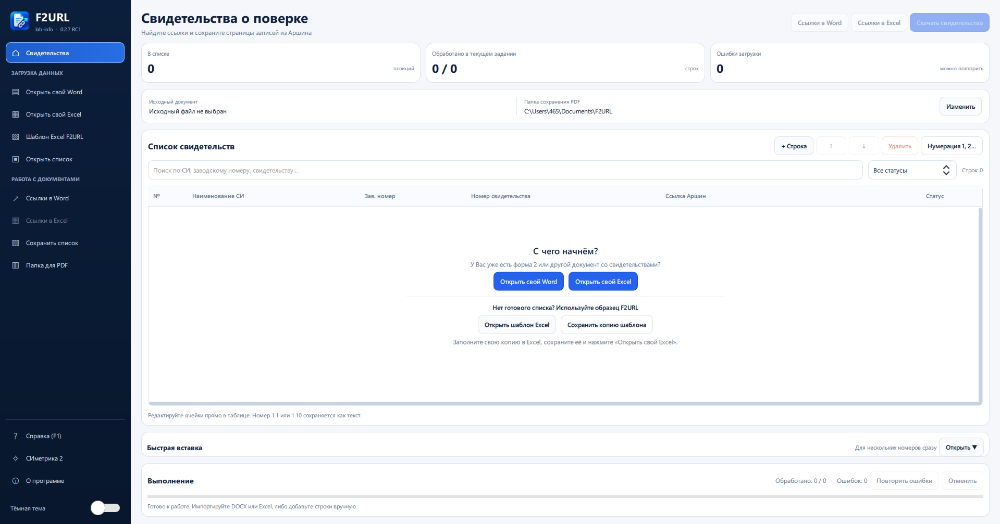
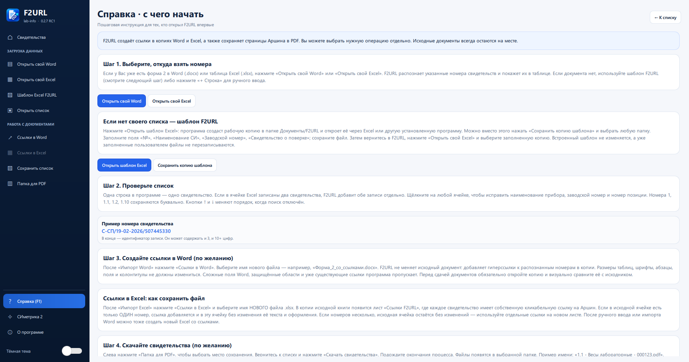
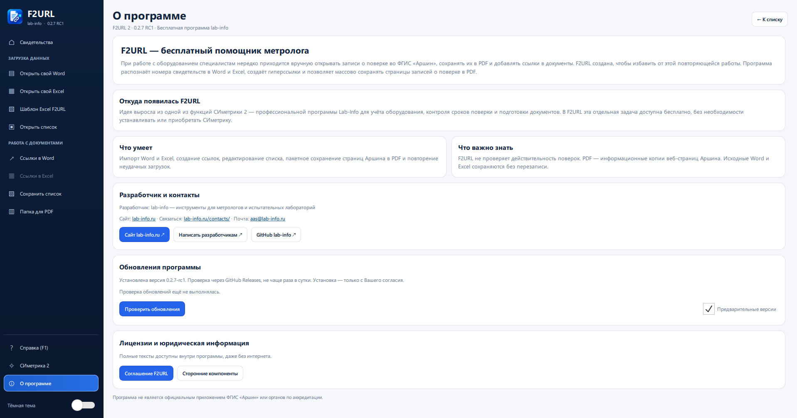

# F2URL 2

**Бесплатная программа Lab-Info для создания гиперссылок на записи о поверке и массового сохранения публичных страниц ФГИС «Аршин» в PDF.**

Специалистам испытательных лабораторий и метрологических служб нередко приходится вручную открывать записи о поверке, добавлять гиперссылки в формы и сохранять страницы реестра. F2URL 2 помогает автоматизировать эту повторяющуюся работу.

> **Windows 10/11 x64.** Бесплатное использование без обязательной регистрации. Собственный исходный код F2URL в этом репозитории не публикуется.

## Скачать программу

Первый выпуск **F2URL 0.2.7 RC1 Compact** подготовлен. Установщик будет доступен на странице [Releases](https://github.com/labinforu/f2url2/releases) после публикации релиза.

- Установщик: `F2URL-0.2.7-rc1-Compact-Setup.exe`.
- Размер установщика: **156,6 МиБ**. SHA-256: `b4c96c706d26315e127ae44025d5df82f7995708c4406ebde53a9d31731e2466`. Контрольная сумма подтверждена данными загруженного файла GitHub Releases.
- Python, Qt и Chromium уже входят в автономный установщик; дополнительно устанавливать их не нужно.
- При установке можно выбрать папку; в меню «Пуск» создаётся группа **Lab-Info → F2URL 2** с ярлыками программы, документации, лицензий и удаления.
- Для получения страниц из ФГИС «Аршин» необходимо подключение к интернету.

[Инструкция по установке](INSTALL.md) · [Описание выпуска](RELEASE_NOTES.md)

## Как выглядит программа

Скриншоты F2URL 2 версии 0.2.7 RC1. Изображения можно открыть в полном размере.

### Главная страница

Выбор собственного Word или Excel, встроенного шаблона F2URL и действий со свидетельствами.

### Встроенная справка

Пошаговые объяснения для первого запуска, работы с шаблоном и создания гиперссылок.

### О программе

Сведения о Lab-Info, лицензиях, контактах и проверке обновлений через GitHub.

## Возможности

- **Microsoft Word:** распознавание номеров записей о поверке в файлах `.docx`, добавление гиперссылок в копию документа с осторожным сохранением структуры и оформления.
- **Microsoft Excel:** создание гиперссылок в копии `.xlsx`. При нескольких номерах в одной ячейке отдельные ссылки создаются на дополнительном листе.
- **PDF из Аршина:** пакетное сохранение веб-страниц записей в PDF через встроенный Chromium Headless; прогресс, отмена и повтор неудачных заданий.
- **Подготовка списка:** отдельные кнопки для собственных Word/Excel, встроенный шаблон Excel (открыть или сохранить копию), ручное редактирование и перемещение строк, номера `1`, `1.1`, `1.2` и сохранение проекта.
- **Удобство:** русскоязычный интерфейс, встроенная справка (F1), раздел «О программе» и тексты лицензий.
- **Обновления:** проверка новых выпусков GitHub, скачивание установщика после подтверждения пользователя и проверка SHA-256 перед запуском; пользовательские файлы не должны удаляться при обновлении.

**Важно:** F2URL не проверяет действительность поверки. PDF представляет собой информационную копию публичной веб-страницы, а не подписанный оригинал свидетельства. Результаты и оформление документов необходимо проверять самостоятельно. Исходные Word/Excel не должны перезаписываться программой.

## Связь с СИметрикой 2

F2URL выделяет одну повседневную задачу из **СИметрики 2** — профессиональной программы Lab-Info для учёта средств измерений и оборудования, контроля поверок, графиков и метрологической документации.

**СИметрика 2 — коммерческая программа с бесплатным демонстрационным режимом.** Демо активируется самостоятельно, полная лицензия оформляется через разработчика. **[Скачать демоверсию СИметрики 2 с официального сервера Lab-Info](https://lab-info.ru/wp-content/uploads/%D0%A1%D0%98%D0%BC%D0%B5%D1%82%D1%80%D0%B8%D0%BA%D0%B0_2_Setup_2.0.0.exe)**. Доступность файла следует проверить перед публичным выпуском. Для использования F2URL покупать СИметрику не нужно.

## Документы и обратная связь

- [Установка](INSTALL.md) · [Частые вопросы](FAQ.md)
- [Описание выпуска](RELEASE_NOTES.md) · [История изменений](CHANGELOG.md)
- [Условия бесплатного использования](LICENSE.txt)
- [Используемые компоненты и лицензии](THIRD_PARTY_NOTICES.txt)
- [Безопасность](SECURITY.md)
- [Сообщить об ошибке или предложить улучшение](https://github.com/labinforu/f2url2/issues/new/choose)

**Разработчик:** Lab-Info  
**Сайт:** https://lab-info.ru/  
**Контакты:** https://lab-info.ru/contacts/  
**Электронная почта:** aas@lab-info.ru

F2URL — независимое программное обеспечение Lab-Info, не являющееся официальным продуктом Росстандарта или ФГИС «Аршин».
